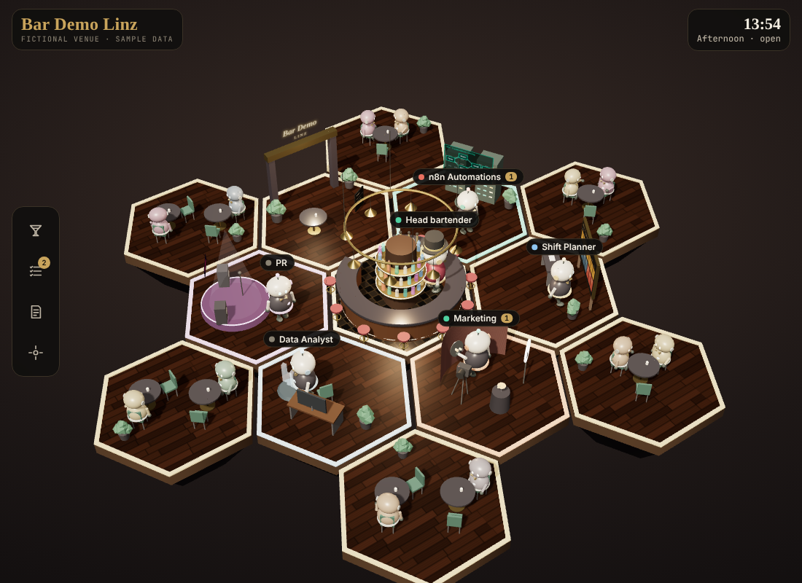

# AI Office – Bar Demo Linz

> ⚠️ **All data in this repository is fictional.** Bar Demo Linz is an invented venue. Names, staff, shifts, sales figures, reviews and stock levels are made up for demonstration. None of it describes a real business or real people.

An "AI office" for a small hospitality business: four AI agents (n8n automations, Data Analyst, Marketing, PR) plus a shift planner, each working in its own thread, coordinated through one web portal.

## What is inside

| Folder | Contents |
| --- | --- |
| `portal/` | The portal: a 3D bar where each "waiter" is one agent (`index.html`), screenshots, and the rules agents follow when writing to the portal (`AKO-ZAPISOVAT-DO-PORTALU.md`). |
| `docs/` | Agent documents: n8n hand-off for the portal, shift rota, Marketing agent spec (system prompt + JSON output), weekly sales report, sales data source options. |
| `n8n/` | Summary of the n8n workflows (daily shift checklist, low-stock alert, error alert, marketing agent). |
| `data/` | Fictional sales data for 19–25 Oct 2026 (line items and daily totals). |
| `portal-log/` | Example agent log (what each agent did, status, time). |

## Notes

- The portal was built as a Claude artifact. Its live features (task queue, agent log, file upload, "head bartender" chat) use the Claude artifact runtime and do not work when the file is opened on its own. The 3D scene still renders.
- Private details were removed before publishing: e-mail addresses, Google Sheets/Drive links, the n8n instance address and private thread links. They appear as placeholders such as `<owner-email>`.
- No API keys or tokens are stored here. To run the n8n workflows you need your own n8n instance, Google account and AI API key.
- Most documents are written in Slovak; the portal interface is in English.

---

## Po slovensky

> ⚠️ **Všetky dáta sú vymyslené.** Bar Demo Linz neexistuje. Mená, zamestnanci, smeny, predaje, recenzie a zásoby sú len ukážka.

AI kancelária pre malý podnik: štyria AI agenti (n8n automatizácie, Dátový analytik, Marketing, PR) a plánovač smien, spojení cez jeden portál v podobe 3D baru.

- `portal/` – portál a pravidlá zápisu do neho
- `docs/` – dokumenty agentov (smeny, marketing, report predajov, zdroj dát, podklady pre n8n)
- `n8n/` – zhrnutie automatizácií
- `data/` – vymyslené predaje za 19.–25. 10. 2026
- `portal-log/` – ukážka denníka agentov

Súkromné údaje (e-mail, odkazy na Google tabuľky, adresa n8n, odkazy na vlákna) sú nahradené zástupným textom. Kľúče ani heslá tu nie sú.
